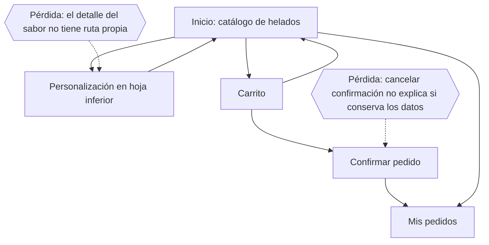

# CP1 · Auditoría UX

Pantallas seleccionadas: catálogo de helados, carrito y confirmación del
pedido. El catálogo es la pantalla de lista que consulta `GET /api/products`.

## Hallazgos

| Pantalla | Problema observado | Principio | Severidad | Arreglo propuesto |
| --- | --- | --- | --- | --- |
| Catálogo | La carga usa un indicador aislado y no anticipa la forma de las tarjetas. | Visibilidad del estado | Alta | Mostrar esqueletos con la forma de la cuadrícula de sabores. |
| Catálogo | El modo demo se comunica con texto pequeño y depende principalmente del color beige. | Información redundante | Media | Añadir icono, etiqueta semántica y texto más legible. |
| Catálogo | El resultado vacío de búsqueda no ofrece una acción directa. | Recuperación y control | Media | Ofrecer limpiar búsqueda y filtros. |
| Catálogo | Favoritos cambia de icono, pero no anuncia el nuevo estado a tecnologías de asistencia. | Retroalimentación accesible | Alta | Exponer estado seleccionado y confirmación semántica. |
| Catálogo | Dos tarjetas por fila dejan poco espacio a nombres largos en 360 px. | Diseño responsivo | Alta | Usar una columna en teléfonos estrechos y más columnas según el ancho. |
| Carrito | Quitar la última unidad elimina la línea sin confirmación ni opción de deshacer. | Prevención de errores | Alta | Confirmar la eliminación o mostrar acción Deshacer. |
| Carrito | Los botones de cantidad tienen tooltip, pero el valor nuevo no se anuncia. | Retroalimentación | Media | Etiquetar el control y anunciar la cantidad actual. |
| Confirmación | El botón se habilita aunque el nombre todavía sea inválido; el error aparece solo después de enviarlo. | Prevención de errores | Alta | Validar al escribir y deshabilitar el envío mientras el formulario sea inválido. |
| Confirmación | El error de red aparece como texto dentro del formulario y puede pasar inadvertido. | Visibilidad del estado | Alta | Mantener el mensaje junto al formulario y anunciarlo como región activa. |
| Confirmación | Volver durante un formulario diligenciado no advierte que se perderán los datos. | Control del usuario | Media | Pedir confirmación antes de descartar cambios. |

## Navegación actual

La navegación principal usa tres destinos persistentes: Helados, Carrito y Mis
pedidos. La personalización y la confirmación son tareas secundarias dentro del
flujo de compra.

## Evidencia pendiente

Antes de cerrar CP1 se deben capturar en `docs/img/`:

- `before-catalogo.png`
- `before-carrito.png`
- `before-confirmacion-pedido.png`

Las capturas deben salir de la línea base `0525f15`, sin cambios de CP2.
