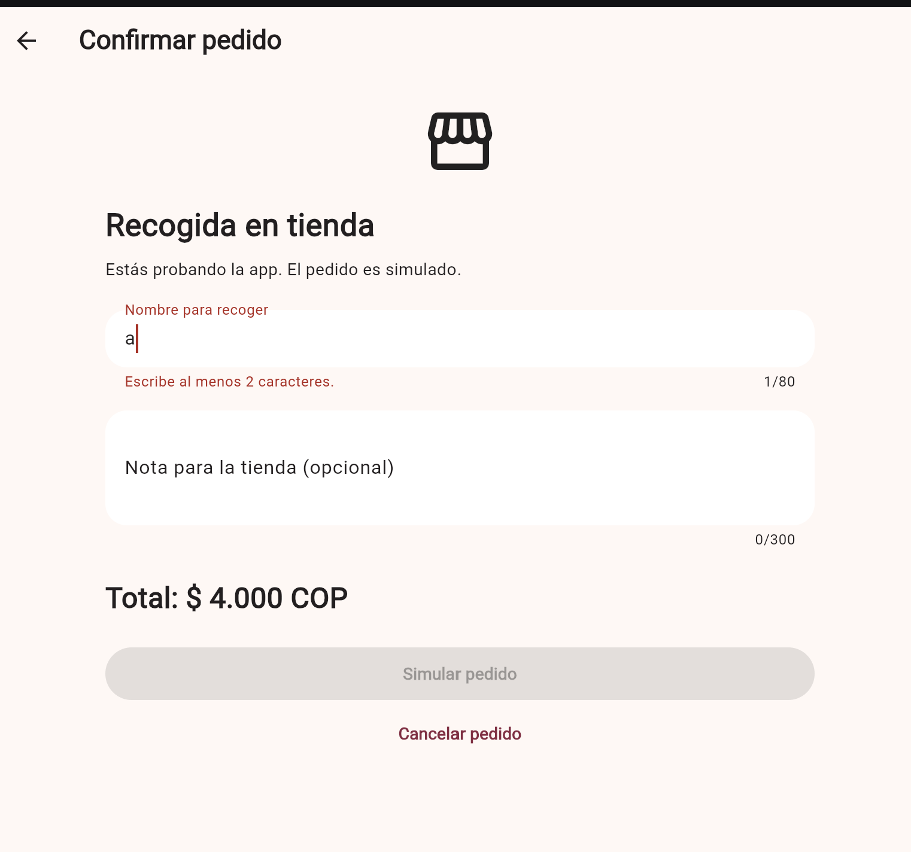
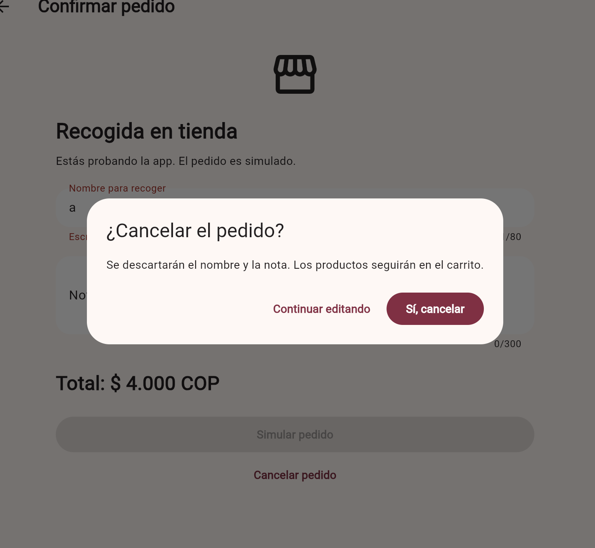
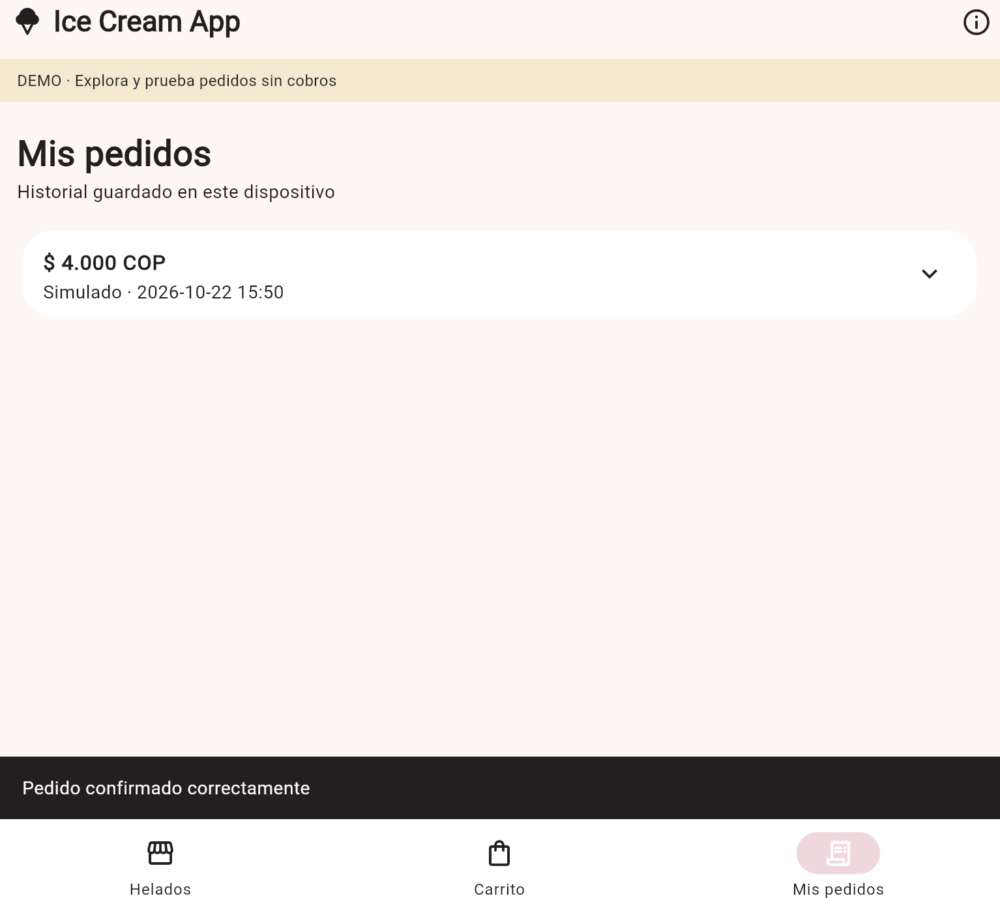
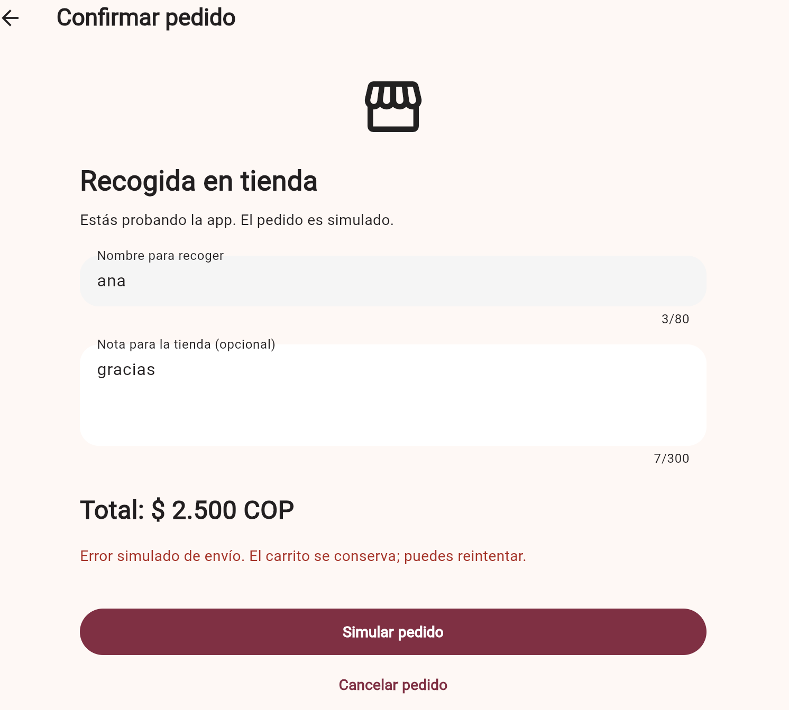
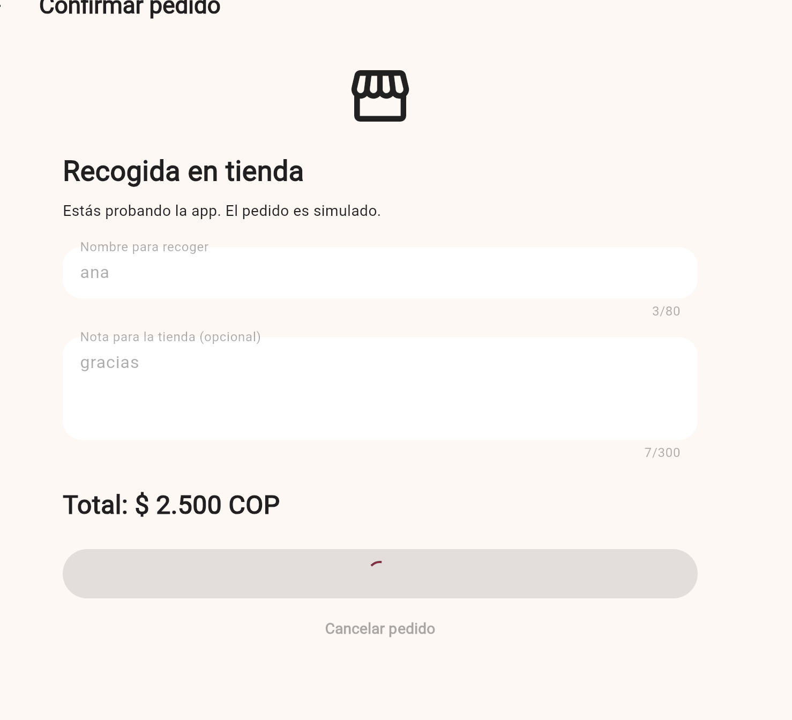

# CP6 · Formulario de confirmación del pedido

El formulario principal confirma un pedido para recoger en tienda. Recibe los
productos configurados en el carrito, el nombre de quien recoge y una nota
opcional.

## Reglas de validación

| Campo o dato | Regla | Razón del dominio |
| --- | --- | --- |
| Carrito | Debe contener al menos un helado | No existe un pedido sin productos. |
| Nombre para recoger | Obligatorio, entre 2 y 80 caracteres | La tienda necesita identificar a la persona y evitar nombres vacíos. |
| Nombre para recoger | Se eliminan espacios al inicio y al final | Impide aceptar entradas compuestas solo por espacios. |
| Nota para la tienda | Opcional, máximo 300 caracteres | Permite una instrucción breve sin enviar contenido excesivo. |
| Total | Se calcula desde productos, tamaños, toppings y cantidades | El cliente no puede alterar el valor que valida el servidor. |
| Cantidad | Entre 1 y 20 unidades por configuración | Evita cantidades negativas o pedidos accidentales excesivos. |

## Retroalimentación

- El formulario valida el nombre durante la escritura.
- El botón permanece deshabilitado mientras los datos sean inválidos o se esté
  enviando el pedido.
- Durante el envío se muestra un indicador de progreso y se bloquea la salida.
- Un error del servidor aparece en una región activa y el carrito se conserva.
- Al completar el pedido se muestra “Pedido confirmado correctamente” y se abre
  Mis pedidos.
- Cancelar abre un diálogo de confirmación; los productos permanecen en el
  carrito aunque se descarten el nombre y la nota.

## Verificación técnica

`flutter test --no-pub`: ocho pruebas aprobadas. La prueba de cancelación
comprueba que la flecha Atrás y el regreso del sistema solicitan confirmación,
que continuar editando conserva el nombre y que confirmar la salida conserva
el carrito sin crear un pedido.

Una prueba con una respuesta controlada verifica el indicador de envío, los
campos y la cancelación deshabilitados, y el bloqueo del regreso durante el
envío. Ante un error, el formulario conserva el nombre y el carrito, muestra el
mensaje y vuelve a habilitar el envío. Esta simulación no acredita una conexión
real con el servidor.

También se verifica el flujo de catálogo, detalle, personalización y pedido
simulado.

## Referencias del equipo

- [Confirmar pedido](https://github.com/code-corhuila/ica-docs/blob/main/01-architecture/screens/confirmar-pedido.md): procesamiento, confirmación y error recuperable.
- [Validación del servidor](https://github.com/pablo12968/ica.app/blob/main/backend/src/order.ts): nombre de 2 a 80 caracteres, nota de hasta 300 y cantidades de 1 a 20.

## Evidencia guardada

Nombre de una sola letra: se muestra el mensaje de validación y el botón de
envío permanece deshabilitado.



Antes de descartar los datos, el diálogo explica que el nombre y la nota se
perderán y que los productos permanecerán en el carrito. Permite continuar
editando o confirmar la cancelación.



Al confirmar el pedido en modo demo, se abre Mis pedidos, aparece el pedido
simulado por $4.000 COP y se muestra “Pedido confirmado correctamente”.



En la prueba de error simulado, se conservan el nombre, la nota y el total.
El mensaje informa que el carrito se conserva y el botón permite reintentar.



Durante la demora de prueba aparece el indicador de carga dentro del botón;
el nombre, la nota y la cancelación permanecen deshabilitados.



## Reproducción de envío y error

Para reproducir estos estados en el navegador:

```text
flutter run -d web-server --web-port 8082 --dart-define=DEMO_CHECKOUT_DELAY_MS=12000 --dart-define=DEMO_CHECKOUT_ERROR=true
```

Sin `API_URL`, estas opciones demoran el pedido de demo durante 12 segundos y
devuelven un error explícitamente simulado. No representan una caída de un
servidor real. Sin esas opciones, la demo sigue confirmando pedidos normalmente;
en modo conectado no se aplican.

La prueba específica con `DEMO_CHECKOUT_ERROR=true` también fue aprobada:
el intento fallido conserva el carrito y no crea un pedido en el historial.
