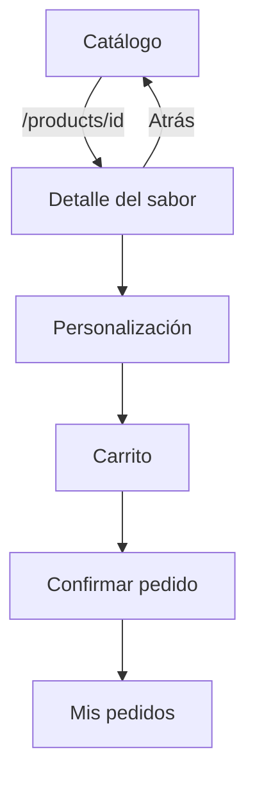
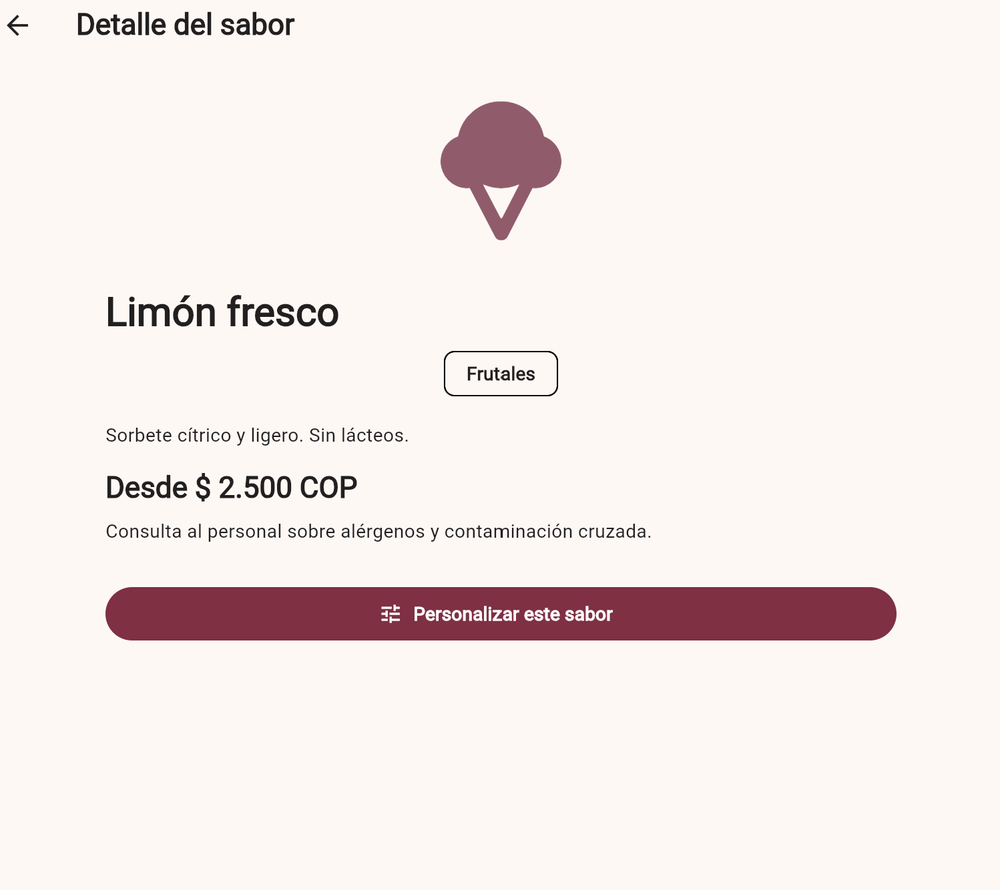
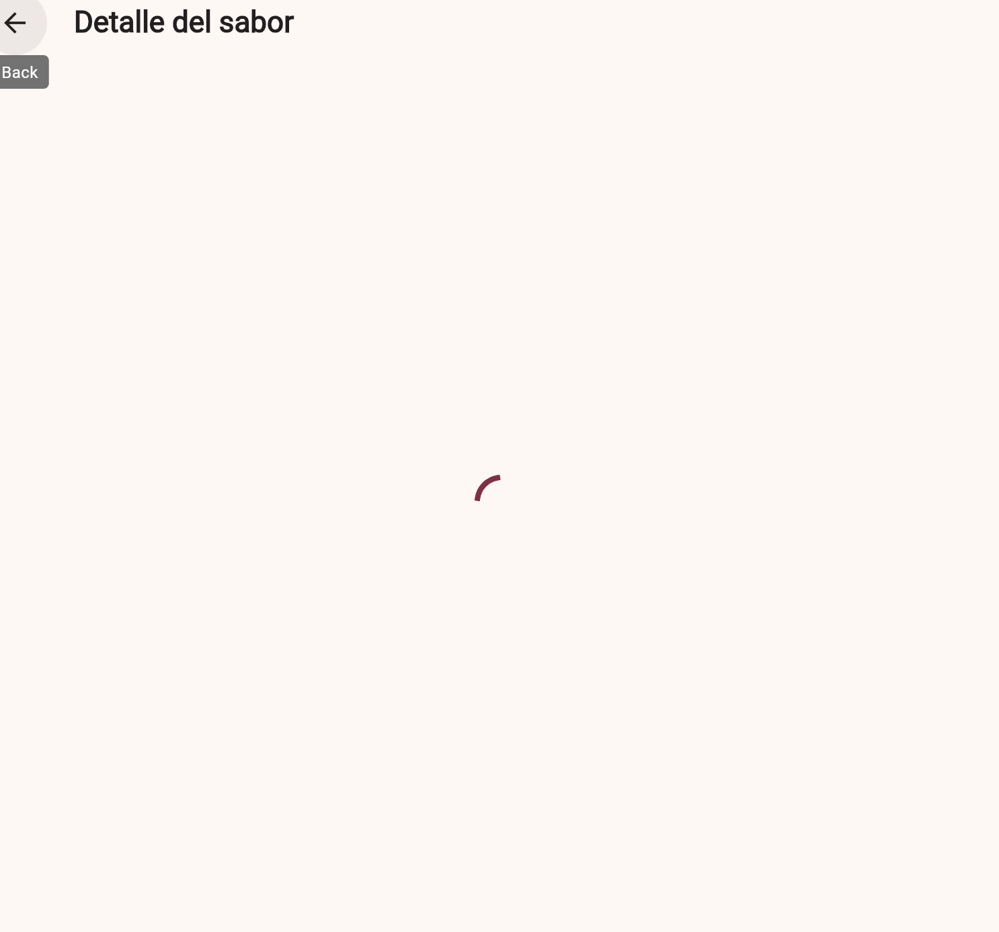
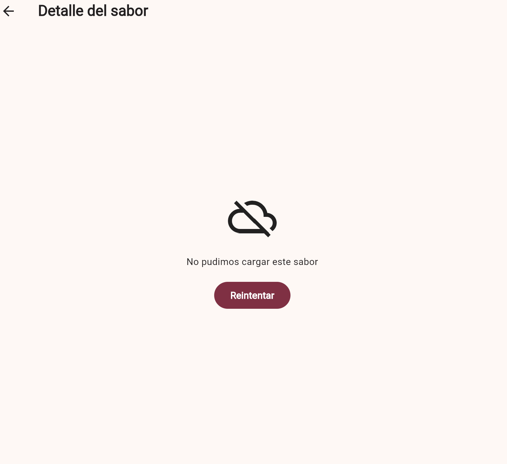
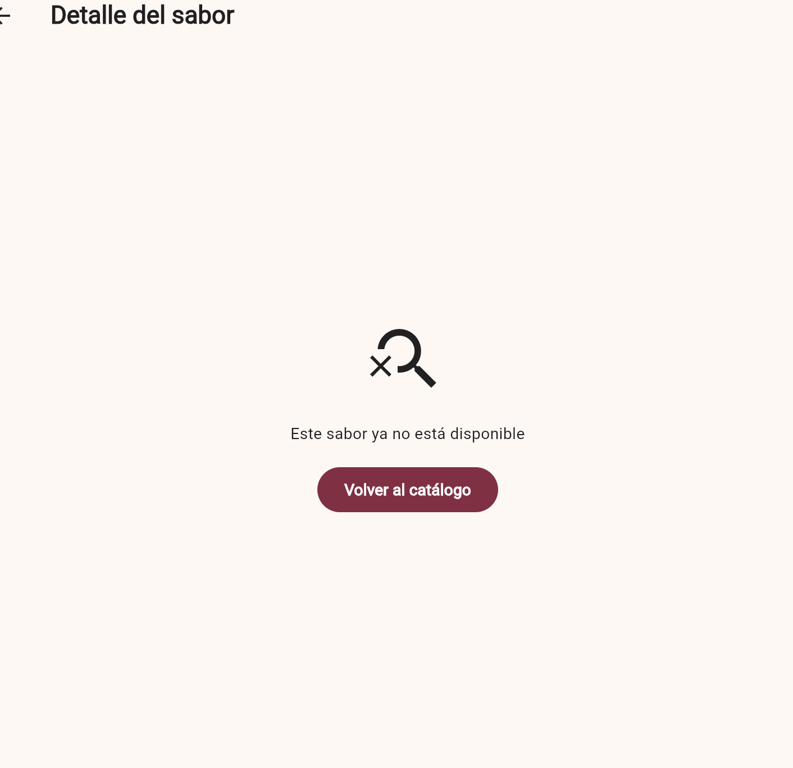

# CP7 · Detalle y flujo de navegación

Cada tarjeta del catálogo abre una pantalla de detalle con la ruta
`/products/{id}`. La ruta conserva el identificador del sabor seleccionado y el
botón Atrás regresa al mismo catálogo, con la búsqueda y los filtros actuales.

La pantalla muestra nombre, categoría, descripción, precio base y advertencia de
alérgenos. Desde allí se abre la personalización existente y después continúa el
flujo real de carrito, confirmación e historial.



## Estados del detalle

- Carga: indicador anunciado como región activa.
- Datos: información del sabor y acción para personalizar.
- Error: mensaje recuperable con el botón Reintentar.
- No encontrado: informa que el sabor ya no está disponible y vuelve al catálogo.

Para revisar error y no encontrado se ejecuta, respectivamente,
`flutter run --dart-define=DETAIL_MODE=error` y
`flutter run --dart-define=DETAIL_MODE=not-found`.

Para capturar la carga se puede añadir `--dart-define=DETAIL_DELAY_MS=12000`.
La demora normal es de 450 ms. `DETAIL_MODE=error` y `DETAIL_MODE=not-found`
provocan estados de prueba; no demuestran un fallo de servidor real.

## Comparación con CP1

En CP1, tocar un sabor abría directamente la personalización en una hoja
inferior. Ahora se abre primero el detalle identificado por `/products/{id}`,
con descripción, precio y advertencia de alérgenos antes de elegir los extras.
Esto añade una pantalla al recorrido de compra; no reduce el número de pasos.
Permite revisar la información sin iniciar la personalización y regresar al
catálogo conservando su búsqueda y sus filtros.

La confirmación de salida de CP6 evita descartar el formulario por accidente.
El carrito y el historial siguen siendo destinos de la navegación principal.

En la comprobación manual, Atrás devolvió al catálogo y seleccionar un sabor
distinto mostró la información correspondiente a esa nueva selección.

## Verificación técnica

`flutter test --no-pub`: diez pruebas aprobadas. Las pruebas del detalle
verifican el indicador de carga, la información del sabor seleccionado por su
identificador y el regreso al catálogo cuando se solicita un identificador
inexistente. El flujo de compra completo también permanece aprobado.

Prueba visual de carga y error:

```text
flutter run -d web-server --web-port 8083 --dart-define=DETAIL_MODE=error --dart-define=DETAIL_DELAY_MS=12000
```

Prueba visual de no encontrado:

```text
flutter run -d web-server --web-port 8084 --dart-define=DETAIL_MODE=not-found
```

## Evidencia guardada

Detalle de Limón fresco: categoría Frutales, descripción, precio base de
$2.500 COP, advertencia de alérgenos y acción para personalizar el sabor.



Durante la demora controlada de 12 segundos, el detalle muestra un indicador
de carga antes de resolver la consulta.



Con `DETAIL_MODE=error`, la consulta de prueba falla y se muestra un mensaje
con la acción Reintentar. Este fallo está provocado para verificar la interfaz.



Con `DETAIL_MODE=not-found`, se muestra el aviso de sabor no disponible y una
acción para regresar al catálogo. Es un estado provocado para la captura;
la prueba automatizada también verifica un identificador inexistente.


