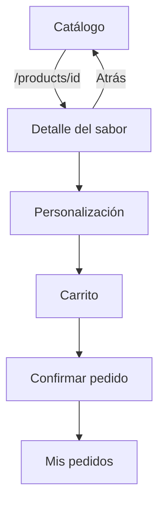

# CP7 · Detalle y flujo de navegación

Cada tarjeta del catálogo abre una pantalla de detalle con la ruta
`/products/{id}`. La ruta conserva el identificador del sabor seleccionado y el
botón Atrás regresa al mismo catálogo, con la búsqueda y los filtros actuales.

La pantalla muestra nombre, categoría, descripción, precio base y advertencia de
alérgenos. Desde allí se abre la personalización existente y después continúa el
flujo real de carrito, confirmación e historial.

## Estados del detalle

- Carga: indicador anunciado como región activa.
- Datos: información del sabor y acción para personalizar.
- Error: mensaje recuperable con el botón Reintentar.
- No encontrado: informa que el sabor ya no está disponible y vuelve al catálogo.

Para revisar error y no encontrado se ejecuta, respectivamente,
`flutter run --dart-define=DETAIL_MODE=error` y
`flutter run --dart-define=DETAIL_MODE=not-found`.

## Evidencia pendiente

- `docs/img/after-detalle-carga.png`
- `docs/img/after-detalle-datos.png`
- `docs/img/after-detalle-error.png`
- `docs/img/after-detalle-no-encontrado.png`
