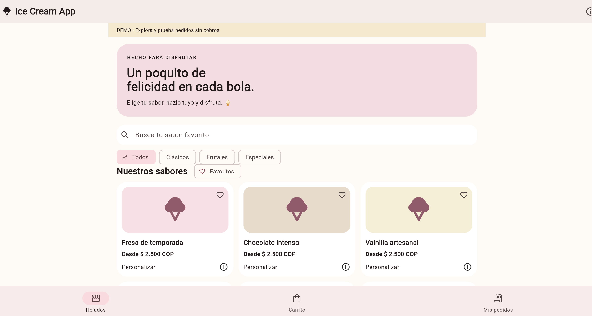
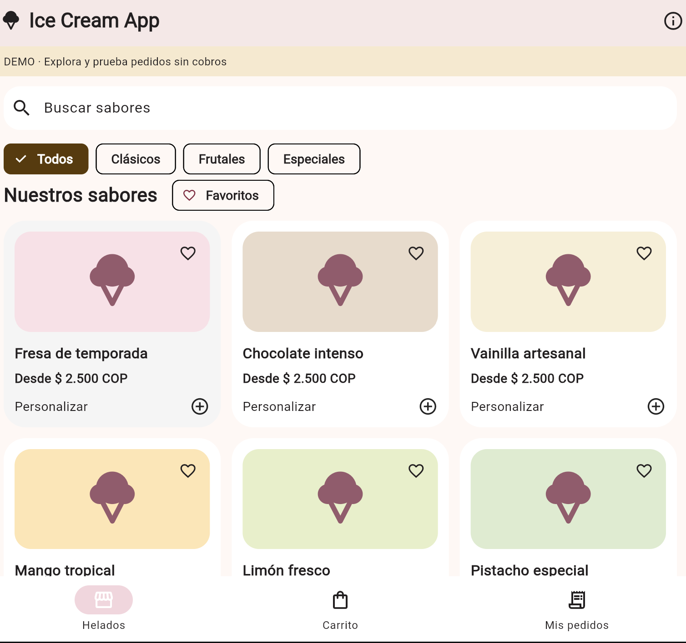
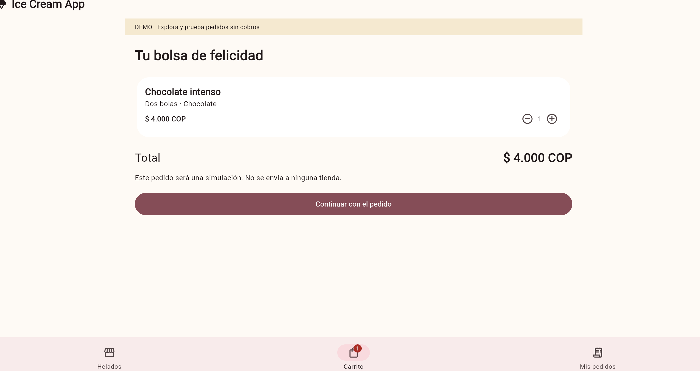
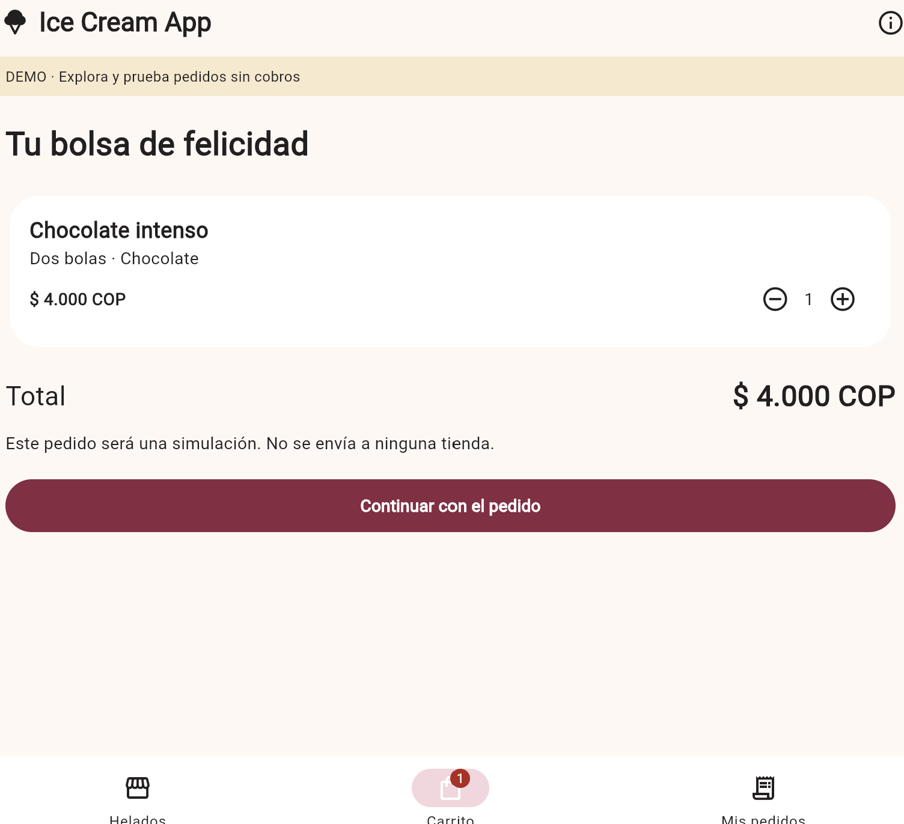
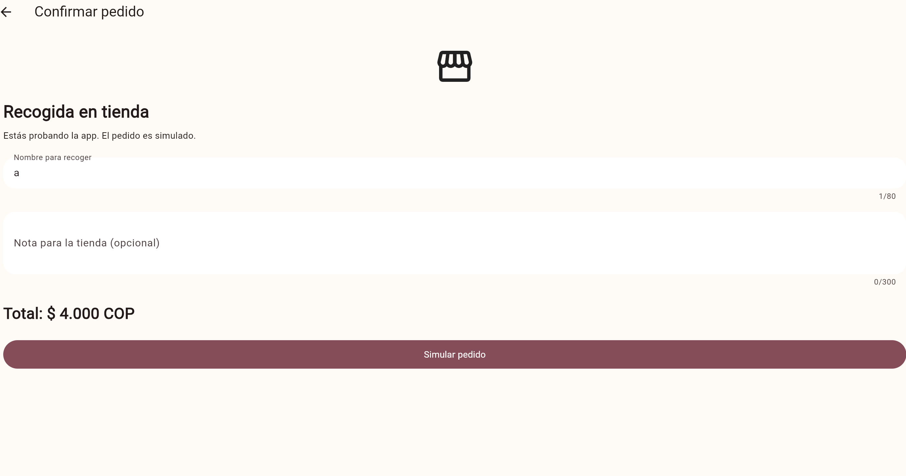
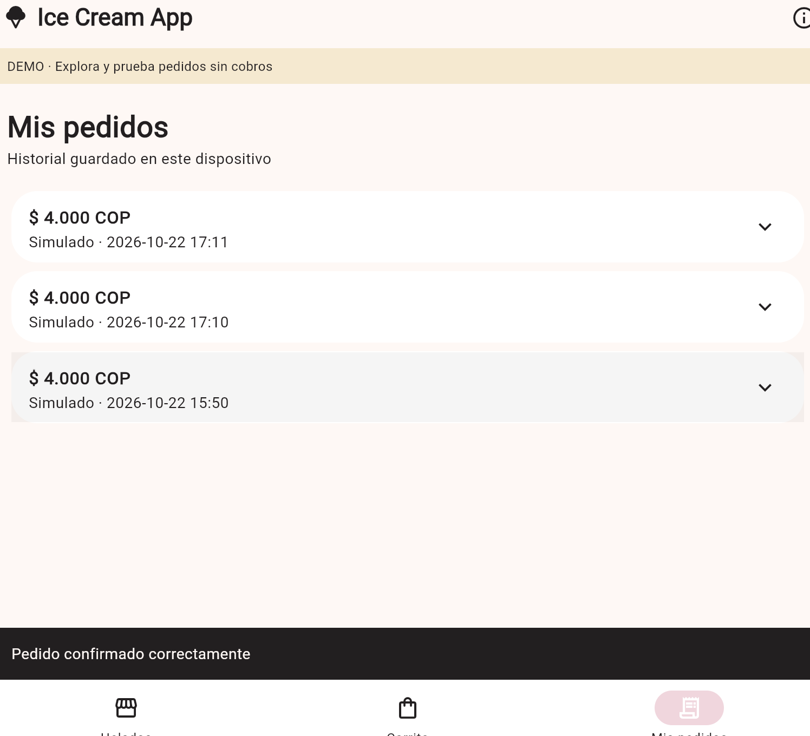

# CP9 · Antes y después e historias para el equipo

## Estado

Comparación técnica preparada con capturas reales. CP8 sigue pendiente de las
pruebas con dos personas y de la corrección de un hallazgo. Este documento no
presenta las mejoras como resultados de esas pruebas. La reflexión CP9 debe
escribirla el estudiante en su documento personal antes de cerrar el checkpoint.

## Procedencia de las capturas

Las capturas `before-` corresponden a la línea base `0525f15`, ejecutada sin
modificar su código en una copia separada, en `localhost:8085`. Las capturas
`after-` corresponden a la versión del taller con CP6 y CP7, en `localhost:8081`.
Las ventanas y los recortes tienen tamaños diferentes: la comparación muestra
comportamientos y elementos de interfaz, no una medición de tamaños o contraste.

## Catálogo

| Antes | Después |
| --- | --- |
|  |  |

El catálogo actual elimina el bloque promocional grande y da prioridad a la
búsqueda y a los sabores. Principio: jerarquía visual y reducción de información
que compite con la tarea principal.

## Carrito

| Antes | Después |
| --- | --- |
|  |  |

Ambas capturas muestran Chocolate intenso, dos bolas y chocolate, por $4.000 COP.
Se conserva la estructura y se aplican los tokens visuales compartidos.
Principio: consistencia; estas imágenes no demuestran una mejora de usabilidad
medida ni una confirmación al eliminar la última unidad.

## Confirmación del pedido

| Antes | Después |
| --- | --- |
|  |  |

Antes, con el nombre `a`, el botón seguía habilitado y no aparecía una indicación
inmediata. Ahora se explica el mínimo de dos caracteres y se deshabilita el envío.
Principios: prevención de errores y retroalimentación junto al campo.

La confirmación de salida conserva el carrito; durante el envío se bloquean los
controles y, ante un error, se conserva lo escrito para reintentar. Las capturas
y la distinción entre demo normal y error simulado están en [CP6](06-forms.md).

## Detalle del sabor

| Antes | Después |
| --- | --- |
| No existía una pantalla de detalle independiente: desde el catálogo se abría la personalización en una hoja inferior. |  |

Se incorpora una pantalla por identificador con descripción, categoría, precio y
advertencia de alérgenos antes de personalizar. Principios: información para
decidir y control de navegación. Añade un paso; no se afirma que reduzca clics.
El mapa y los estados se documentan en [CP7](07-navigation-flow.md).

## Evidencia complementaria

El historial muestra el pedido simulado y la confirmación. Esta captura no es una
prueba con participantes ni acredita seguimiento de pedidos en tiempo real.

## Historias para el backlog del equipo

### 1. Confirmar pedidos con validación y recuperación

Como persona que recoge un pedido, quiero conocer los errores del formulario
antes de enviarlo para poder corregirlos sin perder mi selección.

Criterios de aceptación:

- Un nombre vacío, de espacios o de una letra impide enviar y muestra una explicación junto al campo.
- El nombre admite de 2 a 80 caracteres y la nota hasta 300, de acuerdo con la validación del servidor.
- Durante el envío se muestra progreso y se bloquean los campos, el envío repetido y la salida.
- Cancelar o volver pide confirmación; continuar editando conserva los datos y confirmar la salida conserva el carrito.
- Un error conserva los datos y permite reintentar; el éxito muestra confirmación y abre Mis pedidos.

### 2. Consultar el detalle del sabor y regresar al catálogo

Como persona que elige un helado, quiero consultar sus características antes de
personalizarlo para decidir qué sabor añadir al carrito.

Criterios de aceptación:

- Seleccionar un sabor abre `/products/{id}` con el identificador correspondiente.
- El detalle muestra nombre, categoría, descripción, precio y advertencia de alérgenos.
- Se distinguen carga, datos, error con Reintentar y no encontrado con regreso al catálogo.
- Atrás conserva la búsqueda y los filtros del catálogo.
- Personalizar este sabor continúa con el mismo producto y permite completar el flujo de compra.

### 3. Mantener un catálogo accesible en distintos anchos

Como persona que consulta sabores desde el teléfono, quiero buscar y filtrar
productos con controles legibles para encontrar una opción y recuperarme cuando
no haya resultados.

Criterios de aceptación:

- A 360 px de ancho, los nombres y las acciones de las tarjetas no se superponen ni requieren desplazamiento horizontal.
- La búsqueda y los filtros actualizan los resultados; el estado vacío ofrece limpiar los criterios.
- La carga se comunica y un fallo ofrece Reintentar sin cerrar la aplicación.
- Los favoritos exponen su estado seleccionado a las tecnologías de asistencia.
- Los controles táctiles mantienen un área mínima de 48 dp y usan los tokens compartidos.

Estas historias proponen llevar las mejoras al repositorio del equipo; no
significan que ya estén integradas allí. La prioridad posterior a CP8 debe
revisarse con los resultados reales.
